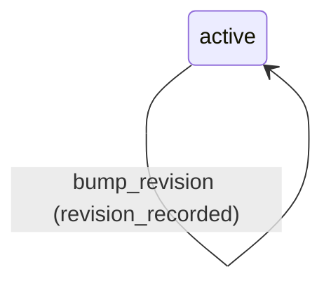

# Requirement Truth: prism-ip-continuity-v1（v0.0.1 · IP 级连续性）

## 人话

一个 IP 会持续创作、长篇连载。L3 管**时间轴**：

1. **演进链**：IP 的正典从 R1→R2→…→Rn 改了什么、为什么改、影响哪些资产——必须有记录。
2. **连续性审计**：同一个 IP 的资产被多集引用时，各自用的版本（`resolved_revision`）不一致、
   又没有演进记录支撑 → 报"版本漂移"（warning，供审计，不阻断）。
3. **season**：一季 = 按 IP 聚合的一组 campaign（复用现有 campaign，不新造 series 对象）。
4. **按 IP 视图**：给 intel/master/director 一个确定性入口，只看某个 IP 的版本链 + 作品引用清单。

- 能做：revisions/ 演进链对象；season 对象（复用 campaign）；确定性视图/校验脚本；漂移审计。
- 不能做：新增生产链；改 IP 正典（只读投影）；替 QA 下 verdict；发布自动化。
- 怎样算完：Intent Matrix must 全 covered；每 AC 有可执行 TC；truth review + integrity + clarity 通过后再 freeze。

## User Intent

> L3 IP 级连续性：revision 演进链记录、跨集 resolved_revision 漂移审计、
> season=按 IP 聚合的多 campaign、按 IP 的版本/引用视图。

## User Intent Snapshot

```yaml
lake_or_ocean: 湖
this_lake: L3（prism-ip-model program）
user_decision: promoted
scope_mode: phased_lake
feature: prism-ip-continuity-v1
version: v0.0.1
depends_on: prism-ip-schema-v1（L1 released）
```

## Intent Coverage Matrix

| intent_id | source | strength | landing | status |
|-----------|--------|----------|---------|--------|
| INT-001 | prompt | must | AC-IPC-001（演进链记录） | covered |
| INT-002 | prompt | must | AC-IPC-002（按 IP 视图脚本） | covered |
| INT-003 | prompt | must | AC-IPC-003（漂移审计） | covered |
| INT-004 | prompt | must | AC-IPC-004（season 聚合） | covered |
| INT-005 | source_evidence | should | AC-IPC-005（复用 campaign） | covered |
| INT-006 | source_evidence | should | AC-IPC-006（校验脚本） | covered |

## Acceptance Criteria

| AC ID | Description |
|-------|-------------|
| AC-IPC-001 | IP 每次 `canon_revision` 跳变须有 `content/ips/{ip_id}/revisions/{R}.yaml`，含 `revision`、`reason`、`affected_assets[]`；从 `canon_revision` 起点到当前值的每一跳缺记录即 blocked，reason_code 为 `revision_chain_incomplete` |
| AC-IPC-002 | 确定性脚本 `scripts/check_ip_continuity.sh view --ip {ip_id}` 输出该 IP 的版本链（R1→…→Rn）与作品引用清单（含各作品的 `resolved_revision`），输出为稳定排序的文本 |
| AC-IPC-003 | 连续性审计：同一 IP 资产被多于一个作品引用、且各自 `resolved_revision` 不一致、且不存在对应演进记录时，报告 `continuity_revision_drift` 并列出冲突项；该情形为 warning，退出码为 0（只审计不阻断） |
| AC-IPC-004 | `content/ips/{ip_id}/seasons/{season_id}.yaml` 含 `season_id` 与 `campaign_refs[]`（项数 ≥ 1），且每个引用的 campaign 同属该 IP；不满足即 blocked，reason_code 为 `season_ip_mismatch` |
| AC-IPC-005 | season 复用现有 `campaign` 对象（一个 IP 对应多个 campaign），不新增 series 对象；`contracts/ip.schema.yaml` 增补 `seasons` 段（可选） |
| AC-IPC-006 | 确定性脚本 `scripts/check_ip_continuity.sh` 校验演进链与 season；违规时非零退出并打印 reason_code；须支持 `--self-test` 与 `--invert` |

## 关键对象清单

- 演进记录 `content/ips/{ip_id}/revisions/{R}.yaml`：`revision`、`reason`、`affected_assets[]`、`recorded_at`。
- season `content/ips/{ip_id}/seasons/{season_id}.yaml`：`season_id`、`campaign_refs[]`。
- 视图输出：版本链 + 作品引用清单（含 `resolved_revision`）。
- 门 reason_code：`revision_chain_incomplete`、`season_ip_mismatch`、`continuity_revision_drift`（warning）。

## FSM 五元组

| State | Event | Guard | To | Action |
|-------|-------|-------|-----|--------|
| active | bump_revision | revision_recorded | active | inc_revision |
| active | open_season | campaigns_same_ip | active | add_season |
| active | audit | — | active | report_drift |

**终态：** archived（IP 归档后只读）

### invalid / illegal

- illegal: bump_revision without revisions/{R}.yaml record
- illegal: open_season with campaign from another IP
- illegal: 审计结果直接修改 IP 正典（视图只读）

## Non-goals

- 新增生产链或改 IP 正典（只读投影）
- 替 QA 下 verdict
- 发布自动化
- 替 L2 联名授权（L3 只做时间轴/视图）

## Provenance

Each AC traces to a confirmed user intent or source-evidence (see frontmatter provenance).

## Source Excerpt

```markdown
L3 IP 级连续性：revision 演进链记录、跨集 resolved_revision 漂移审计、season=按 IP 聚合的多 campaign、按 IP 的版本/引用视图。
```

## FSM mermaid（投影）


