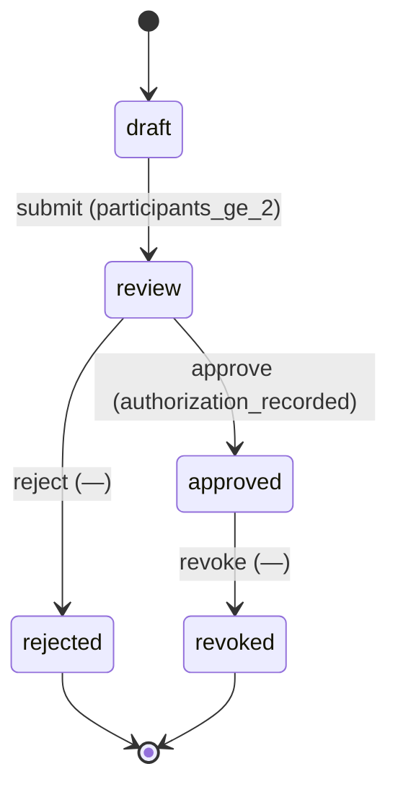

# Requirement Truth: prism-ip-import-gate-v1（v0.0.1 · 联名执行门）

## 人话

L1 让作品能**声明**引用别的 IP 的资产；L2 让它**被把关**。

联名（一个作品引用 ≥2 个 IP）是**多个创作主体的合作**，所以放行前必须满足：
1. **授权**：参与 IP 的主体同意这次联名（谁、用到什么程度）。
2. **披露**：对外标明是联名/品牌合作（接 F1 披露义务）。
3. **署名/分成**：谁挂名、收益怎么分（接 F1 变现 / F2 改编）。
4. **正典不打架**：任一参与 IP 正典未冻结即阻断（复用 L1）。

- 能做：新增联名授权对象与契约；执行门（授权/披露/分成/正典）；确定性校验脚本；与 F1/F2 叠加的 hook。
- 不能做：代写正文；替 F1/F2 下变现/改编授权结论；发布自动化；改 L1 已冻结契约的必填面。
- 怎样算完：Intent Matrix must 全 covered；每 AC 有可执行 TC；truth review + integrity + clarity 通过后再 freeze。

## User Intent

> L2 联名执行门：imports 涉及 ≥2 IP 须有授权记录、披露文本、署名/分成，接 F1 变现与 F2 改编；
> 正典聚合门复用 L1。

## User Intent Snapshot

```yaml
lake_or_ocean: 湖
this_lake: L2（prism-ip-model program）
user_decision: promoted
scope_mode: phased_lake
feature: prism-ip-import-gate-v1
version: v0.0.1
depends_on: prism-ip-schema-v1（L1 released）
```

## Intent Coverage Matrix

| intent_id | source | strength | landing | status |
|-----------|--------|----------|---------|--------|
| INT-001 | prompt | must | AC-IPG-001（联名对象与契约） | covered |
| INT-002 | prompt | must | AC-IPG-002（授权门） | covered |
| INT-003 | prompt | must | AC-IPG-003（披露门） | covered |
| INT-004 | prompt | must | AC-IPG-004（署名/分成门） | covered |
| INT-005 | prompt | must | AC-IPG-005（正典聚合门复用 L1） | covered |
| INT-006 | source_evidence | should | AC-IPG-006（校验脚本） | covered |
| INT-007 | source_evidence | should | AC-IPG-007（与 F1/F2 叠加） | covered |

## Acceptance Criteria

| AC ID | Description |
|-------|-------------|
| AC-IPG-001 | 新增 `crossovers` 内容对象：`registry/content-schema.yaml` 含 `schema_id: crossovers`，`root: content/crossovers/{crossover_id}.yaml`，契约 `contracts/crossover.schema.yaml`；必填 `crossover_id`、`participant_ips`（项数 ≥ 2）、`work_ref`、`authorization`、`attribution` |
| AC-IPG-002 | 当作品 `imports[]` 涉及的 `from` 去重后项数 ≥ 2 时，必须存在 `content/crossovers/{crossover_id}.yaml` 且该项 `authorization.status=approved`；不满足即 blocked，reason_code 为 `crossover_authorization_missing` |
| AC-IPG-003 | 联名记录须含非空 `disclosure_note`；缺失即 blocked，reason_code 为 `crossover_disclosure_missing` |
| AC-IPG-004 | 联名记录声明分成时，`royalty_split` 各项占比合计等于 100%；当 `non_royalty` 显式声明为 true 时豁免该合计约束；两项均不满足即 blocked，reason_code 为 `crossover_royalty_unrecorded` |
| AC-IPG-005 | 联名须逐个校验参与 IP 正典冻结状态：`participant_ips` 中任一项不满足 `status=active` 且正典冻结，即 blocked，reason_code 为 `crossover_canon_unmet`（复用 L1 判定口径） |
| AC-IPG-006 | 确定性校验脚本 `scripts/check_ip_import_gate.sh` 对给定作品与联名记录判定合规；违规时非零退出并打印对应 reason_code；须支持 `--self-test` 与 `--invert` |
| AC-IPG-007 | 与 F1/F2 叠加：联名涉变现时，`contracts/monetization.contract.md` 披露门同时适用；涉改编时，`contracts/adaptation.contract.md` 授权门同时适用；两门均记录 hook 引用且不互相替代 |

## 关键对象清单

- 联名记录 `content/crossovers/{crossover_id}.yaml`：`crossover_id`、`participant_ips[]`（≥2）、`work_ref`、`authorization{status,approved_by,approved_at,scope}`、`disclosure_note`、`attribution[]`、`royalty_split[]`、`canon_refs[]`。
- 门 reason_code：`crossover_authorization_missing`、`crossover_disclosure_missing`、`crossover_royalty_unrecorded`、`crossover_canon_unmet`。

## FSM 五元组

| State | Event | Guard | To | Action |
|-------|-------|-------|-----|--------|
| draft | submit | participants_ge_2 | review | — |
| review | approve | authorization_recorded | approved | set_approved |
| review | reject | — | rejected | — |
| approved | revoke | — | revoked | — |

**终态：** revoked（不可从 rejected 直接 approved）

### invalid / illegal

- illegal: draft → approved without authorization_recorded
- illegal: approved → 发布 while disclosure_note 为空
- illegal: 参与 IP 非 active 时提交 review

## Non-goals

- 代写正文或替 QA 下 verdict
- 替 F1 变现承诺 / F2 改编授权下结论（只留 hook + 叠加）
- 发布自动化
- 修改 L1 已冻结契约的必填面

## Provenance

Each AC traces to a confirmed user intent or source-evidence (see frontmatter provenance).

## Source Excerpt

```markdown
L2 联名执行门：imports 涉及 ≥2 IP 须有授权记录、披露文本、署名/分成，接 F1 变现与 F2 改编；正典聚合门复用 L1。
```

## FSM mermaid（投影）


