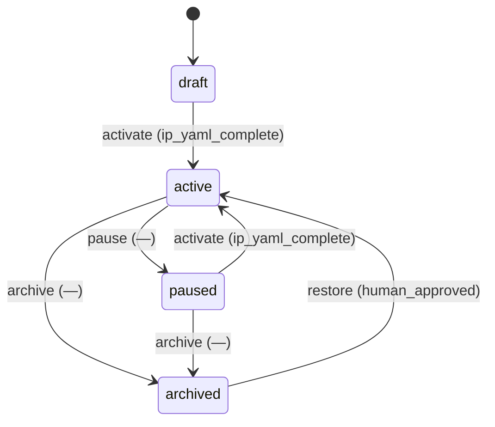

# Requirement Truth: prism-ip-schema-v1（v0.0.1 · IP 轴与跨项目资产引用）

## 人话

你要做的是一个 **IP**——会持续更、会联名、会连载的内容身份。

Prism 现在能把角色/场景/道具当"常量"逐字复用（identity block 冻结），**但只在自己的项目里**：
分镜里的 `asset_ref` 是个本地名字，`ref_image` 是个本地路径，换个项目就找不到。

这个需求就干一件事：**把"资产"升级成有全局地址、能被别的项目 import 的东西**。

1. **建 IP**：`content/ips/{ip_id}/`，里面放这个 IP 的正典资产（人物/场景/道具/风格），
   每个资产有自己的稳定 `asset_id` 和冻结的 identity block。
2. **能引用**：作品（分镜/单集/战役/母稿）写 `imports:`，指明"从哪个 IP 取哪个资产"，
   解析时把源 IP 的 identity block **逐字**注入提示词——一个字都不改，所以跨项目也是同一张脸。
3. **跟最新**：默认 `track: latest`，取源 IP 当前最新的冻结资产；解析那一刻把当时版本
   （`resolved_revision`）记下来，保证产物可复现、能追溯。
4. **联名**：一个作品 `imports` 指向两个 IP，就是联名；这时**两个 IP 都必须冻好**才让生成。
5. **旧资产搬家**：现有 `storyworld/characters` 和 `masters/.../assets` 里的资产，登记进 IP，旧引用做兼容。

- 能做：IP 对象与资产登记；import 声明与解析（逐字注入 + 落盘 revision + fail-closed）；联名聚合正典门；校验脚本；存量资产收敛迁移。
- 不能做：实现生成/渲染链（Lake D 已交付，本包不动）；跨 IP 授权与分成（Lake F 已交付，本包只留钩子）；发布自动化；宣称海级 closure。
- 怎样算完：Intent Matrix must 全 covered；每条 AC 有可执行 TC；truth review + integrity + clarity 通过后再 freeze。

## User Intent

> 为 Prism 引入 IP 轴：IP = 跨项目可引用的正典资产库。新建 `content/ips/{ip_id}/`
> （`ip.yaml` + `assets/{characters,scenes,props,styles}/<asset_id>`），作品侧支持
> `imports[]:{from,asset,track:latest|revision}` 逐字注入源 IP 冻结 identity block；
> 存量 storyworld/master 资产收敛登记进 IP；多源 import 聚合正典门 fail-closed。

## User Intent Snapshot

```yaml
lake_or_ocean: 湖
this_lake: L1（prism-ip-model program）
user_decision: promoted
scope_mode: phased_lake
sea_promise: full_selfmedia_creation_capability
feature: prism-ip-schema-v1
version: v0.0.1
decisions:
  D1: 命名 ip（content/ips/{ip_id}/）
  D2: import 引用零副本，不做目录根、不复制资产
  D3: asset_id 在 IP 内寻址；跨 IP 引用带 from；imports[] 可选不回填旧文
  D4: 默认 track: latest，解析落盘 resolved_revision
  D5: 联名聚合正典门 AND fail-closed
  D6: 存量资产收敛进 IP
```

## Intent Coverage Matrix

| intent_id | source | strength | landing | status |
|-----------|--------|----------|---------|--------|
| INT-001 | prompt | must | AC-IPM-001（IP 对象与资产库） | covered |
| INT-002 | prompt | must | AC-IPM-002（资产条目资产化） | covered |
| INT-003 | prompt | must | AC-IPM-003（imports 声明，默认跟最新） | covered |
| INT-004 | prompt | must | AC-IPM-004（逐字注入 + resolved_revision + fail-closed） | covered |
| INT-005 | prompt | must | AC-IPM-005（多源联名聚合正典门） | covered |
| INT-006 | decision | must | AC-IPM-008（存量资产收敛） | covered |
| INT-007 | prompt | should | AC-IPM-006（校验脚本） | covered |
| INT-008 | source_evidence | should | AC-IPM-007（docs/prism 同构含 ips/） | covered |

## Acceptance Criteria

| AC ID | Description |
|-------|-------------|
| AC-IPM-001 | 注册 `ip` 内容对象：`registry/content-schema.yaml` 含 `schema_id: ip`，`root: content/ips/{ip_id}/`，`contract: contracts/ip.schema.yaml`；`ip.yaml` 必填字段为 `ip_id`、`title`、`kind`（`fact`、`story`、`brand`）、`status`（`draft`、`active`、`paused`、`archived`）、`canon_revision`、`publish_identity_ref` |
| AC-IPM-002 | IP 资产条目位于 `content/ips/{ip_id}/assets/{characters,scenes,props,styles}/<asset_id>/`，含稳定 `asset_id`、`canon_revision`、冻结 identity block（7 段）、引用图文件；`asset_id` 在同一 IP 内唯一；跨 IP 引用一律带 `from` 限定 |
| AC-IPM-003 | 作品侧契约（`master-content`、`storyworld`、`campaign`、`narrative-episode`）各含可选字段 `imports[]`，元素字段为 `from`、`asset`、`track`、`revision`；`track: latest` 为缺省语义；旧内容不强制回填该字段 |
| AC-IPM-004 | import 解析逐字注入源 IP 冻结 identity block；`track: latest` 解析时将源 IP 当时的 `canon_revision` 落盘为 `resolved_revision`；源 IP 不存在、源 IP 未冻结、资产缺失、已钉 `revision` 与源不符，四类情形均 fail-closed 并给出对应 reason_code，禁止静默本地重描述 |
| AC-IPM-005 | 当一个作品的 `imports[]` 指向两个及以上 IP 时，要求全部被引用 IP 的 `status=active` 且正典已冻结；任一不满足则 blocked，reason_code 为 `crossover_canon_unmet` |
| AC-IPM-006 | 校验脚本 `scripts/check_ip_model.sh` 可验证：IP 已注册；`ip.yaml` 必填字段齐全；`imports[]` 引用可解析到存在的 `ip_id` 与 `asset_id`；同一 IP 内 `asset_id` 唯一；违规时非零退出并打印 reason_code |
| AC-IPM-007 | `check_prism_project_docs.sh --init-shape` 对 `docs/prism` 的同构断言包含 `ips/`（`content/` 新增 `ips/` 后，项目侧 `docs/prism/ips/` 自动纳入同构比对） |
| AC-IPM-008 | 存量资产收敛：`content/storyworlds/*/characters|scenes|props/` 与 `content/masters/*/*/assets/` 的资产条目登记进对应 IP 的 `content/ips/{ip_id}/assets/`；迁移脚本幂等且不丢资产（迁移前后资产清单计数一致）；`storyworld`/`master` 经 `imports[]` 引用 IP 资产；旧路径保留 alias 兼容期并有校验断言 |

## 关键对象清单

| 对象 | 位置 | 性质 |
|---|---|---|
| IP | `content/ips/{ip_id}/ip.yaml` | 创作身份 + 正典资产命名空间 + 发布身份，生命周期 `draft→active→paused→archived` |
| IP 资产 | `content/ips/{ip_id}/assets/<类>/<asset_id>/` | 冻结 identity block(7段) + 引用图 + 谱系（base/variant/evolution），`canon_revision` 随 IP 演进 |
| import 声明 | 作品侧 `imports[]` | 引用边（零副本），`from`+`asset`+`track|revision` |
| resolved_revision | 作品产物 | 解析时刻源 IP 版本落盘，保证可复现 |

## FSM 五元组

| State | Event | Guard | To | Action |
|-------|-------|-------|-----|--------|
| draft | activate | ip_yaml_complete | active | set_active |
| active | pause | — | paused | set_paused |
| active | archive | — | archived | set_archived |
| paused | activate | ip_yaml_complete | active | set_active |
| paused | archive | — | archived | set_archived |
| archived | restore | human_approved | active | set_active |

**终态：** archived

### invalid / illegal

- illegal: archived → active without human_approved
- illegal: import 引用 `draft` 或 `archived` 状态的 IP
- illegal: 已钉 revision 的 import 在源 revision 变更后静默改引用

## Non-goals

- 实现生成/渲染/拼接链（Lake D 已交付，本包不改 `scripts/ai_manga_drama.py` 的渲染语义）
- 跨 IP 授权、署名、分成、披露（Lake F1/F2 已交付；本包只留 import 钩子）
- 发布自动化与平台对接（`prism-publish-bridge` 已交付）
- 存量资产**物理删除**（收敛只做登记 + 引用 + alias，不删源文件）
- 宣称海级 closure

## Provenance

Each AC traces to a confirmed user intent or decision (see frontmatter provenance).

## Source Excerpt

```markdown
为 Prism 引入 IP 轴：IP=跨项目可引用的正典资产库。新建 content/ips/{ip_id}/（ip.yaml + assets/{characters,scenes,props,styles}/<asset_id>），作品侧支持 imports[]:{from,asset,track:latest|revision} 逐字注入源 IP 冻结 identity block；存量 storyworld/master 资产收敛登记进 IP；多源 import 聚合正典门 fail-closed。
```

## FSM mermaid（投影）


