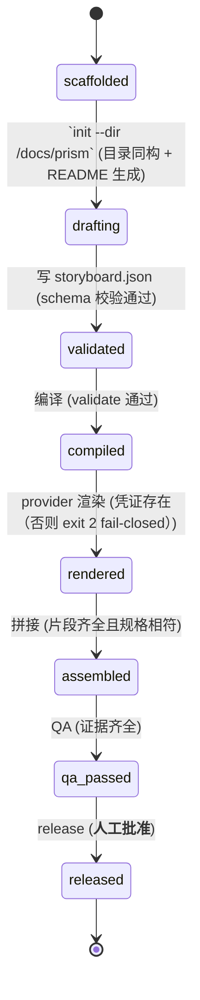

# Requirement Truth: prism-project-docs-v1（v0.0.1 · 项目内 docs/prism 产物层）

## 人话

Prism 之前有个别扭事：把它装到你的项目里，只装了"说明书"，没装"工具"，
所以你在自己项目里跑不了它的命令；而且它到底把剧本分镜写到哪个目录，两份文档说的不一样。

这个需求就干三件事：

1. **给用 Prism 的项目定一个作品目录**：`docs/prism/`，结构照抄 Prism 自己仓库的 `content/`
   （大纲、剧本母稿、分镜、成片索引各归各位），一进门有个 `README.md` 当目录页。
2. **工具怎么够得着**：不往你项目里拷贝任何脚本，只约定一个环境变量 `PRISM_HOME`
   指向 Prism 仓，所有命令写成 `$PRISM_HOME/scripts/...`。工具永远只有一份。
3. **路径打架的事一次说清**：契约文档和管线文档现在各说一个路径，改成只留一条正典，
   另一条标成"旧写法，别再用"，并加自动检查防止以后又改回去。

- 能做：定目录结构与门面 README、写 PRISM_HOME 约定进公开 skill、路径正典化 + 自动断言。
- 不能做：往项目里复制脚本（那是第二份工具，必然漂移）；改 Prism 的产线逻辑与门禁标准；
  替项目决定内容本身怎么写；冻结 manju 蒸馏那批实现（那是另一个 feature）。
- 怎样算完：5 条 AC 全部有可执行 TC；`beacon truth review` 通过；用户显式确认 freeze。

## User Intent

在任意使用 Prism 的项目里，项目 `docs/` 下建一个类比 `docs/beacon/` 的 `docs/prism/` 目录，
保存 Prism 大纲、母稿、分镜剧本等作品产物；能力侧用 `PRISM_HOME` 指路（项目零 scripts 副本），
目录与 prism 仓 `content/` 同构，路径契约唯一化（旧路径标 alias）。
缺口：`install_public_surfaces.sh` 只软链 SKILL.md；契约 §4 与管线 README 路径打架。

## User Intent Snapshot

```yaml
lake_or_ocean: 湖
scope_mode: lake              # 显式声明；运行时可能从 prompt 推断出 brownfield_takeover，
                              # 两者不矛盾：brownfield_takeover 描述仓库形态（既有仓加投影），
                              # lake 描述本包交付范围。以本字段为准（R2 修 planner-review scope-mode finding）
scope_mode_repo_shape: brownfield_takeover
this_lake: 项目内 docs/prism 产物层 + PRISM_HOME 分发约定 + 路径正典化
user_decision: promoted
sea_promise: prism_capability_in_every_project（海：独立 pip CLI / 内容生成本身）
delivery: 本包单湖闭环（5 AC）
feature: prism-project-docs-v1
version: v0.0.1
revision_intent: R2
depends_on: prism-prompt-compiler-v1（已有 --dir 落盘能力，本包不改产线）
decisions_2026_09_29:
  D1: PRISM_HOME 约定（A 方案），项目零能力副本
  D2: docs/prism/ 与 content/ 同构 + 路径唯一化（旧路径 alias + check 断言）
  D3: manju 86 规则蒸馏另成 prism-drama-spec-v1，不入本包
intent_fidelity_note: |
  用户原话三个要件全部落地，无削弱：① "docs 目录下有个 prism 目录" → AC-PDO-001；
  ② "保存 prism 大纲、母版、分镜剧本" → AC-PDO-001 门面 README 三类索引；
  ③ "类 beacon 规范" → AC-PDO-005 与 docs/beacon 边界。
  Phased Backlog 延后项（pip CLI、7 SKILL 全量改写）在用户原话中从未出现，
  是 planner 提出的海级选项且用户已 accepted（Deferral Ledger DEF-001/002），
  不构成对原话的 MVP 削弱（R2 修 intent-fidelity finding）。
```

## Alignment Surface（本 revision 必须闭环）

- 项目侧唯一作品目录：`docs/prism/`，子目录与 prism 仓 `content/` 同名同构。
- 门面文件：`docs/prism/README.md`，索引大纲 / 母稿 / 分镜剧本 / 成片。
- 能力可达方式：`PRISM_HOME` 环境变量（默认 = Prism 仓根），命令一律 `$PRISM_HOME/scripts/...`。
- 路径正典：契约与管线文档只剩一条 canonical，另一处 alias 标注 + `check_*` 断言。
- SoT 归属：能力归 prism 仓，内容归项目仓，双向都不越界。

## Phased Backlog（显式不进本包 closure）

- `pip install prism` 独立 CLI 分发（海级，需单独 program）。
- 7 个 SKILL.md 全文改写为 PRISM_HOME 版本的逐句审校（本包只加约定段 + 一处命令示例改造，全量改写另行）。
- manju 86 规则 / `drama_spec.py` / fixture 的冻结（→ `prism-drama-spec-v1`）。
- 项目侧 `docs/prism/` 内容本身的创作（那是用户的作品，不是本需求的交付物）。

## Intent Coverage Matrix

| intent_id | source | strength | landing | status |
|-----------|--------|----------|---------|--------|
| INT-001 | prompt | must | AC-PDO-001（docs/prism 目录同构 + 门面） | covered |
| INT-002 | prompt | must | AC-PDO-002（PRISM_HOME 可达、零副本） | covered |
| INT-003 | prompt | must | AC-PDO-003（路径唯一化 + alias + 断言） | covered |
| INT-004 | prompt | must | AC-PDO-004（install 缺口：SKILL 指引含能力定位） | covered |
| INT-005 | derived | must | AC-PDO-005（docs/prism 与 docs/beacon 边界） | covered |
| INT-006 | sea | should | 独立 pip CLI 分发 | deferred → Phased Backlog |

## Acceptance Criteria

| AC ID | Description |
|-------|-------------|
| AC-PDO-001 | 项目侧 `init --dir <p>/docs/prism` 落盘的目录树与 prism 仓 `content/` 同构（同名子目录 `briefings/storyworlds/masters/pipelines/produced/distribution`），且生成门面 `docs/prism/README.md`，README 内含大纲/母稿/分镜剧本三类索引条目 |
| AC-PDO-002 | 公开 skill 指令面写明 `PRISM_HOME` 约定：`skills/prism-director/SKILL.md`、`skills/prism-produce/SKILL.md`、`skills/prism-qa/SKILL.md` 三个文件内命令一律写成 `$PRISM_HOME/scripts/...` 形式；项目仓 `git ls-files` 中 `prompt_compiler.py` / `ai_manga_drama.py` / `drama_spec.py` 的命中路径全部位于 `scripts/` 之下（唯一能力 SoT，无副本） |
| AC-PDO-003 | `contracts/form-manga-drama.contract.md §4` 与 `content/pipelines/ai-manga-drama/README.md` 对 episode 产物路径只保留一条 canonical 表述，另一条显式标注 alias/deprecated；存在 `scripts/check_*` 断言两处 canonical 一致（含反向断言：alias 行存在且 canonical 行唯一） |
| AC-PDO-004 | `scripts/install_public_surfaces.sh` 文件头注释明确写出"只装指令面"，并写明能力面经 `PRISM_HOME` 获取；`skills/prism-director/SKILL.md` 含能力定位段（声明 `PRISM_HOME` 与 `scripts/` 关系）；`scripts/check_prism_project_docs.sh --install-notice` 对以上两点 exit 0 |
| AC-PDO-005 | `docs/prism/` 产物中不出现需求真相字段（`slug/status/revision_id/parser_contract` frontmatter），`docs/beacon/` 下不出现分镜/成片产物文件；交叉引用仅允许 `docs/prism/**` 引用 beacon feature slug 单向 |

## FSM 五元组（项目侧一次作品产线）

| State | Event | Guard | To | Action |
|-------|-------|-------|-----|--------|
| scaffolded | `init --dir <p>/docs/prism` | 目录同构 + README 生成 | drafting | 落盘目录树与门面 |
| drafting | 写 storyboard.json | schema 校验通过 | validated | `validate` 过门 |
| validated | 编译 | validate 通过 | compiled | 产提示词 + srt + 分镜脚本 |
| compiled | provider 渲染 | 凭证存在（否则 exit 2 fail-closed） | rendered | 回填 ref_image 与 clips |
| rendered | 拼接 | 片段齐全且规格相符 | assembled | 真实片段拼接 + AI 标识 |
| assembled | QA | 证据齐全 | qa_passed | SCORECARD 落 `.beacon/evidence/qa/` |
| qa_passed | release | **人工批准** | released | 唯一合法公开出口 |

**终态：** released

### invalid / illegal

- illegal: scaffolded → compiled（跳过 schema 校验）
- illegal: compiled → rendered（无凭证 / 无 ref_image 时静默降级）
- illegal: assembled → released（无 qa_passed / 无人工批准）
- illegal: 任何态 → 修改已冻结母稿而不走 refreeze
- illegal: 项目仓出现 scripts/ 能力副本（第二份能力 SoT）

## Non-goals

- 不实现任何 provider 的 HTTP/SDK 调用，不管理凭证。
- 不往项目仓复制 Prism 脚本、schema 或契约（复制 = 第二份能力 SoT = 漂移）。
- 不规定项目 `docs/prism/` 里内容怎么写（那是用户作品）。
- 不替代 `docs/beacon/` 承担需求真相；两者无状态耦合。
- 不含 manju 86 规则蒸馏的实现与冻结（→ `prism-drama-spec-v1`）。
- 不做独立 pip CLI 分发（海级，见 Phased Backlog）。

## Deferral Ledger

| deferral_id | item | reason | user_decision |
|-------------|------|--------|---------------|
| DEF-001 | 独立 pip CLI 分发 | 海级，成本高，非本湖闭环所需 | accepted（延后） |
| DEF-002 | 7 个 SKILL.md 全量 PRISM_HOME 改写 | 本包只加约定段与主入口定位段，全量审校另行 | accepted（延后） |
| DEF-003 | manju 蒸馏实现冻结 | 已单独成 feature，避免混包 | accepted（切分） |

## 关键对象

| Entity | Key | Notes |
|--------|-----|-------|
| ProjectPrismDir | `docs/prism/` | 项目侧作品 SoT；与 content/ 同构 |
| FacadeIndex | `docs/prism/README.md` | 唯一门面：大纲/母稿/分镜索引 |
| PrismHome | `PRISM_HOME` | 能力面定位（环境变量，指 prism 仓根） |
| CanonicalPath | 契约 §4 canonical 行 | episode 产物唯一正典路径 |
| AliasPath | alias/deprecated 行 | 旧路径，只标注不删除（保历史可读） |

## 用户旅程

US-001：新项目用 Prism。装 skill（只装说明书）→ 按指引设 `PRISM_HOME` →
`$PRISM_HOME/scripts/ai_manga_drama.py init --dir ./docs/prism --episode ep-001` →
项目里出现同构目录树 + 门面 README → 写 storyboard → validate → compile → 渲染 → QA → 人工发布。

US-002：项目仓做能力扫描。`git ls-files` 无任何 Prism 脚本副本，只有 `docs/prism/` 下的作品与文本产物。

US-003：读者查路径。打开契约与管线 README，看到同一条 canonical 路径，旧路径带 alias 标注不再误用。

## Source Excerpt

```markdown
在任意使用 Prism 的项目里，项目 docs/ 下建一个类比 docs/beacon/ 的 docs/prism/ 目录，
保存 Prism 大纲、母稿、分镜剧本等作品产物；能力侧用 PRISM_HOME 指路（项目零 scripts 副本），
目录与 prism 仓 content/ 同构，路径契约唯一化（旧路径标 alias）。
缺口：install 只软链 SKILL.md；契约 §4 与管线 README 路径打架。
```

## Provenance

每条 AC 追溯到 frontmatter `provenance`（user_intent / user_decision / source_evidence）。
上游研究：`docs/beacon/v0.0.1/research/prism-project-docs-v1.md`（Decisions D1/D2/D3）。

## FSM mermaid（投影）


