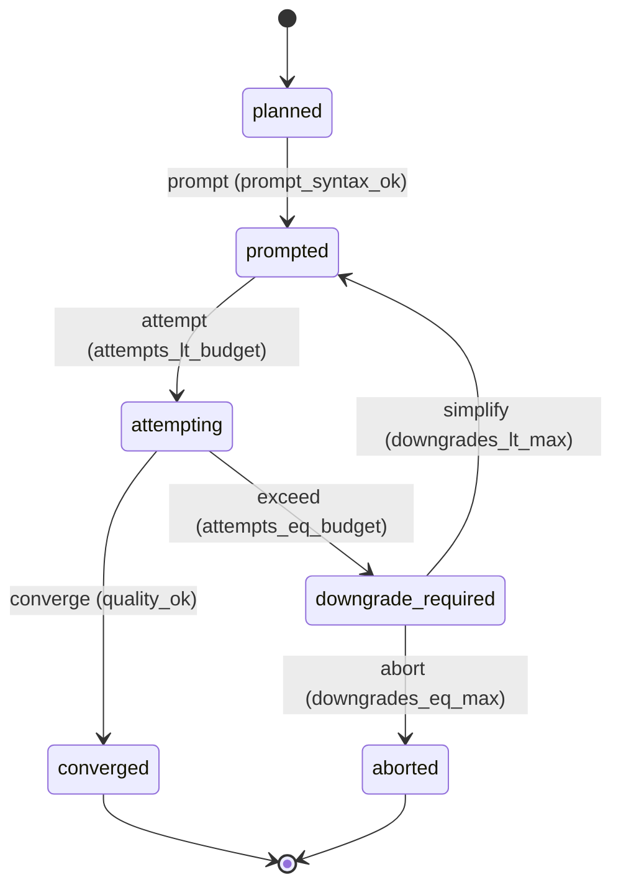

# Requirement Truth: prism-shot-iteration-budget-v1（v0.0.1 · 镜头生成预算与收敛红线）

## 人话

做漫剧/短剧，AI 生视频一次只出约 10 秒，一镜要生成好几版才有一条能用。
没有纪律就会**无限抽卡**——烧钱、交付没准头。这个需求把三条实战纪律变成硬门：

1. **每镜有预算**：一镜最多试 N 次（N 可配）。到顶还没达标，**必须降级**——简化镜头（拆/并/降复杂度）或改镜头设计，不许"再来一版"。
2. **禁止后期配音兜底**：原生对白做不出来，就**改镜头设计**；不许用后期 TTS/配音合成来假装对白成功。
3. **画面里的"不要"无效**：描述画面元素时不能用否定式（"不要 X"），得改肯定式；否则模型不认。
4. **生成前先问"做得到吗"**：定分镜时先声明目标模型，动作/对白必须在它的**可达白名单**内；不可达的，在设计期就退回改镜头，别硬抽。

- 能做：分镜/镜头 schema 加预算与尝试字段；超限降级门；禁后期配音判据；画面否定→肯定式判据；能力域前置门；确定性校验脚本；阈值来源义务。
- 不能做：实现视频生成/渲染/拼接（Lake D 已交付）；provider 计费对接；自动降级策略学习（归 Lake E）；改母稿正典；发布自动化。
- 怎样算完：Intent Matrix must 全 covered；每条 AC 有可执行 TC；truth review + integrity + clarity 通过后再 freeze。

## User Intent

> 为 Prism 加镜头生成预算与收敛红线：每镜迭代上限，超限必须降级（简化镜头 / 改镜头设计），
> 禁止无限抽卡；禁止后期配音兜底（对白失败只能改镜头设计）；画面类否定无效须肯定式表达；
> 生成前做能力域前置门（动作/对白须在目标模型可达白名单内）。

## User Intent Snapshot

```yaml
lake_or_ocean: 湖
this_lake: 生产纪律（独立 feature，与 prism-ip-schema-v1 并行）
user_decision: promoted
scope_mode: single_feature
sea_promise: full_selfmedia_creation_capability
feature: prism-shot-iteration-budget-v1
version: v0.0.1
source_evidence: "https://x.com/jarvis11x/status/2104397648438476868（Muse 漫剧六步法）"
```

## Intent Coverage Matrix

| intent_id | source | strength | landing | status |
|-----------|--------|----------|---------|--------|
| INT-001 | prompt | must | AC-ITB-001（每镜迭代预算） | covered |
| INT-002 | prompt | must | AC-ITB-002（超限降级门） | covered |
| INT-003 | prompt | must | AC-ITB-003（禁后期配音兜底） | covered |
| INT-004 | prompt | must | AC-ITB-004（画面否定→肯定式） | covered |
| INT-005 | prompt | must | AC-ITB-005（能力域前置门） | covered |
| INT-006 | source_evidence | should | AC-ITB-006（校验脚本） | covered |
| INT-007 | source_evidence | should | AC-ITB-007（阈值来源义务） | covered |

## Acceptance Criteria

| AC ID | Description |
|-------|-------------|
| AC-ITB-001 | 分镜/镜头 schema 含 `iteration_budget`（每镜生成上限，正整数）与 `attempts`（实际尝试次数）；当 `attempts` 大于 `iteration_budget` 且无合规降级记录时，判定为 blocked，reason_code 为 `iteration_budget_exceeded` |
| AC-ITB-002 | 超预算的镜头必须附降级记录：`convergence` 取值限定在枚举 `simplified`（简化镜头）、`redesigned`（改镜头设计）内，并带具体降级动作；降级有次数上限（`max_downgrades`），超过即终止该镜（`shot_aborted`），防止无限降级循环 |
| AC-ITB-003 | 证据链中出现"对白由后期合成（TTS / 配音）产生"即 fail-closed，reason_code 为 `post_dub_fallback_forbidden`；provider 原生对白与改设计后无对白两种情形均为合规；与 `assemble` 的 no-fallback 总则一致 |
| AC-ITB-004 | `prompt-syntax` 判定新增：画面元素描述若使用否定式（形如 `no <元素>` 、`不要 <元素>` 描述画面内容）即 blocked，reason_code 为 `image_negation_not_affirmative`；对字幕与音频的否定约束不在此列 |
| AC-ITB-005 | 能力域前置门：produce 前须声明目标 provider 与模型，并校验分镜动作与对白在该模型的 `reachable` 白名单内；动作不可达 → `action_outside_model_domain`，对白不可达 → `dialogue_outside_model_domain`；两类均在**设计期**退回（不进生成） |
| AC-ITB-006 | 确定性校验脚本 `scripts/check_shot_iteration_budget.sh` 可对给定 storyboard 与证据判定两种合规情形：预算未超；预算已超但带合规降级记录。检出画面否定式即失败；检出后期配音兜底即失败；违规时非零退出并打印对应 reason_code |
| AC-ITB-007 | 阈值来源义务：`iteration_budget`、`max_downgrades`、以及能力域 `reachable` 白名单必须标注来源与测试条件（题材 + 模型）；未标注来源的阈值，门报 `threshold_source_missing` |

## 关键对象清单

- 镜头预算：`iteration_budget`（上限）、`attempts`（实际次数）、`convergence`（native / simplified / redesigned）、`max_downgrades`（降级上限）。
- 能力域：`provider`、`model`、`reachable`（动作/对白可达白名单）。
- 反兜底证据：`dialogue_source`（native / redesigned_none / post_dub），`post_dub` 为违规值。

## FSM 五元组

| State | Event | Guard | To | Action |
|-------|-------|-------|-----|--------|
| planned | prompt | prompt_syntax_ok | prompted | — |
| prompted | attempt | attempts_lt_budget | attempting | inc_attempts |
| attempting | converge | quality_ok | converged | record_attempts |
| attempting | exceed | attempts_eq_budget | downgrade_required | block_generate |
| downgrade_required | simplify | downgrades_lt_max | prompted | inc_downgrades |
| downgrade_required | abort | downgrades_eq_max | aborted | stop_shot |

**终态：** converged 或 aborted

### invalid / illegal

- illegal: attempting → converged while attempts 大于 iteration_budget 且无降级
- illegal: post_dub 产物进入 assemble
- illegal: action_outside_model_domain 直接进入 attempting（跳过能力域门）

## Non-goals

- 实现视频生成、渲染、拼接链（Lake D 已交付）
- provider 计费与成本账单对接
- 自动降级策略学习（归 Lake E 学习面）
- 修改母稿正典或 QA 最终 verdict
- 发布自动化

## Provenance

Each AC traces to a confirmed user intent or source-evidence (see frontmatter provenance).

## Source Excerpt

```markdown
为 Prism 加镜头生成预算与收敛红线：每镜迭代上限，超限必须降级（简化镜头 / 改镜头设计），禁止无限抽卡；禁止后期配音兜底（对白失败只能改镜头设计）；画面类否定无效须肯定式表达；生成前做能力域前置门（动作/对白须在目标模型可达白名单内）。
```

## FSM mermaid（投影）


